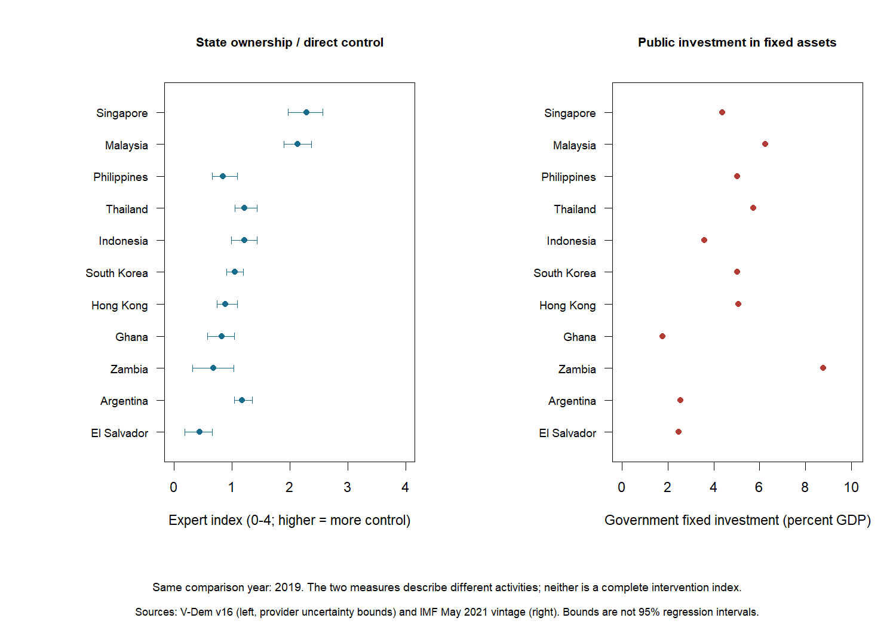
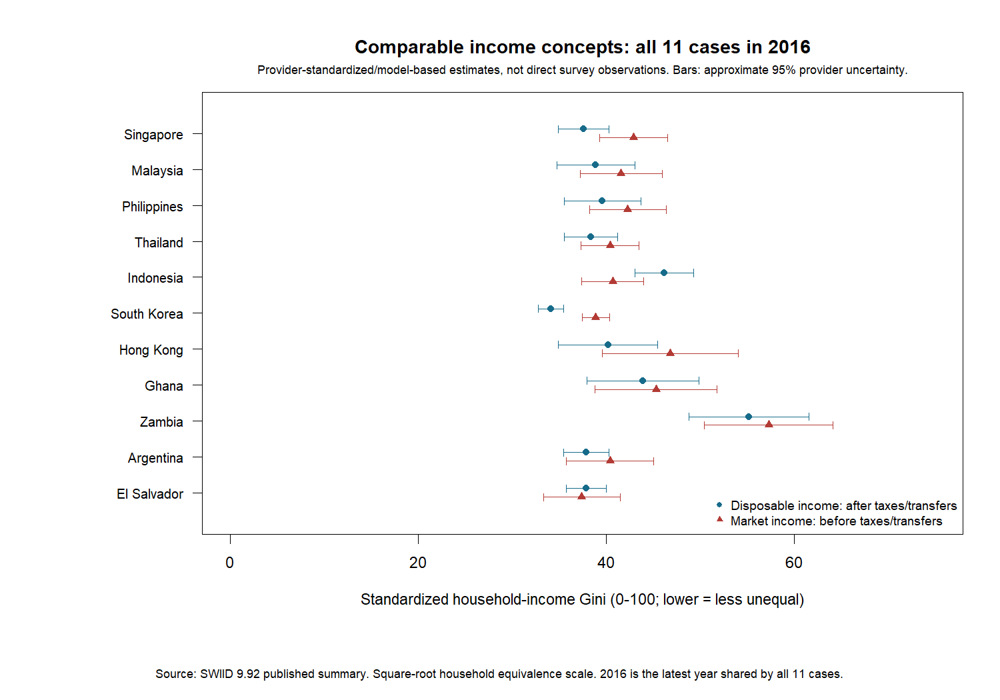

# SODA 308: Singapore Development Model

An R research project for **SODA 308 at Penn State**, comparing Singapore with ten other countries or economies and a broader international reference. It examines economic performance, living standards, happiness, freedom, and social outcomes alongside political institutions and state involvement.

**Status:** exploratory research in progress. Results describe associations, not causal policy effects or proof that Singapore's model transfers elsewhere.

## Start with the results

| What you want | Where to go |
| --- | --- |
| Latest findings and remaining gaps | [Latest findings](docs/better_measure_findings.md) |
| Newest charts and results tables | [Graphs and tables guide](outputs/README.md) |
| Methods in plain language | [Latest methods](docs/better_measure_methods.md) |
| Broader project findings | [Project overview](docs/current_results.md) |
| Data sources and limitations | [Source guide](SOURCE_NOTES.md) |
| Every labeled dataset and results table | [Output catalog](metadata/output_catalog.csv) |

**Download the repository** using GitHub's **Code > Download ZIP**, extract it, and open `outputs/BETTER_MEASURES.html` in a browser. GitHub displays PNG graphs and CSV tables directly; it shows HTML source rather than the full report layout. Open `outputs/START_HERE.html` locally for the complete linked catalog.

### A preview



The ownership index is an expert assessment, not a percentage of state-owned assets. Public investment measures government fixed investment as a share of GDP. Neither covers all state intervention.



These are provider-standardized estimates, not new direct survey observations. The comparison uses **2016**, the latest year shared by all eleven cases in this release. Newer country-specific observations remain in the data.

## Folder guide

| Folder | Purpose |
| --- | --- |
| [outputs/](outputs/README.md) | Browser reports, graphs, readable tables, and saved validation results |
| [data/](data/README.md) | Processed analysis inputs and clearly labeled copies |
| [coursework/](coursework/README.md) | Original papers, planning notes, source inventory, and presentation |
| [docs/](docs/README.md) | Findings, methods, source audits, and development history |
| [metadata/](metadata/README.md) | Definitions, source versions, country matching, and column dictionary |
| [scripts/](scripts/README.md) | R data collection, analysis, and report generation |
| [tests/](tests/README.md) | Source, sample, timing, and repository checks |

Comparison cases are Malaysia, the Philippines, Thailand, Indonesia, South Korea, Hong Kong, Ghana, Zambia, Argentina, and El Salvador. Coverage varies by indicator and year. International reference averages are unweighted available-economy means.

## Reproduce in R

Open `SODA308.Rproj` in RStudio and run:

```r
source("run_all.R")
browseURL(normalizePath("outputs/BETTER_MEASURES.html"))
```

Windows PowerShell:

```powershell
Set-Location 'C:\Users\mikey\Desktop\PSU\SODA 308'
& 'C:\Program Files\R\R-4.5.1\bin\Rscript.exe' run_all.R
```

The workflow installs packages in a local `.R-library`, retrieves or reuses sources, runs analyses, generates labeled outputs, and validates them. Packages are jsonlite, readxl, sandwich, lmtest, and haven plus dependencies. First runs require internet access. No Python or database service is required. Packages are not lockfile-pinned; provider downloads may change or become unavailable. Source versions and checksums document the local snapshot.

Raw downloads and installed R packages are excluded from GitHub. Saved reports, figures, tables, and processed datasets are included. Read [the data guide](data/README.md) before reuse. No blanket data-redistribution license is granted.

To refresh reports from existing analysis files:

```r
source("scripts/05_reader_outputs.R")
```

## Course papers and research design

The [coursework index](coursework/README.md) organizes the supplied papers and presentation under descriptive filenames. [How the papers connect to the analysis](docs/coursework_and_current_analysis.md) explains changes in cases, hypotheses, and measures. Earlier proposals remain distinct from completed results. The separate Pokemon exercise is retained as other coursework.

## Main limitations

- **State intervention:** ownership/control and public investment are different, limited components. Directed credit and detailed industrial policy remain incomplete.
- **Income inequality:** observed PIP surveys remain separate from standardized SWIID estimates. SWIID charts are descriptive; regressions using its supplied statistical draws are withheld because compatibility checks remain unresolved.
- **Social outcomes:** gender inequality is a separate dimension. Hong Kong is missing in that series. There is no universal social score or overall country ranking.
- **Interpretation:** missing data, measurement uncertainty, overlapping indicators, and confounding limit conclusions. The three main ownership-model confidence intervals include zero.

See [methods](docs/better_measure_methods.md), [source decisions](docs/better_measure_sources.md), and [the work log](docs/work_log.md). Earlier phases remain identified in the [documentation guide](docs/README.md).

## Keep GitHub up to date

The working folder is `C:\Users\mikey\Desktop\PSU\SODA 308`. After reviewing edits, run:

```powershell
powershell -NoProfile -File .\sync_github.ps1
```

This commits and pushes changes, honors `.gitignore`, checks the expected branch and remote, and stops if GitHub has changes missing locally. It does not rerun the analysis. See [the sync guide](docs/github_sync.md).

## Visual guide to the paper

Open the [working outline](outputs/PAPER_EVIDENCE_GUIDE.html) in a browser. The [diagram guide](docs/paper_visual_guide.md) displays the three process diagrams directly on GitHub.
