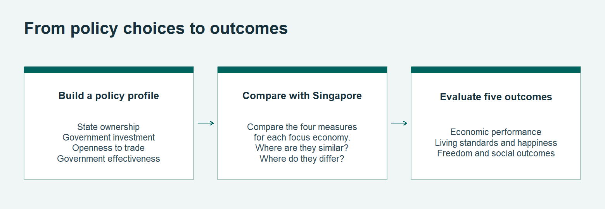
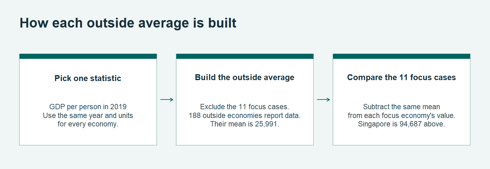
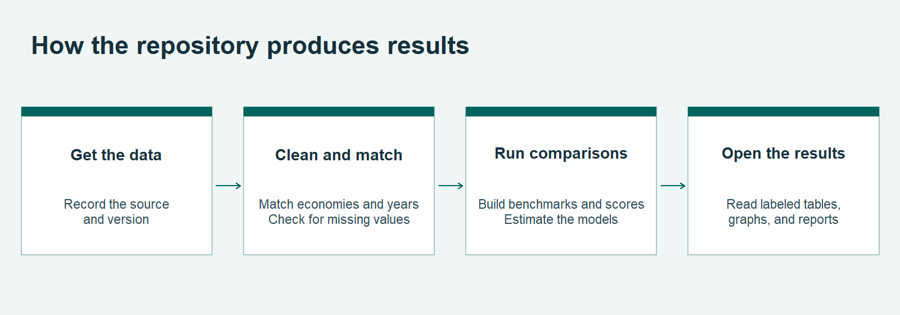

# SODA 308 working outline

[Open the full working outline](../outputs/PAPER_EVIDENCE_GUIDE.html).

## From the policy profile to outcomes

## How each outside average is built

## How the repository produces results

